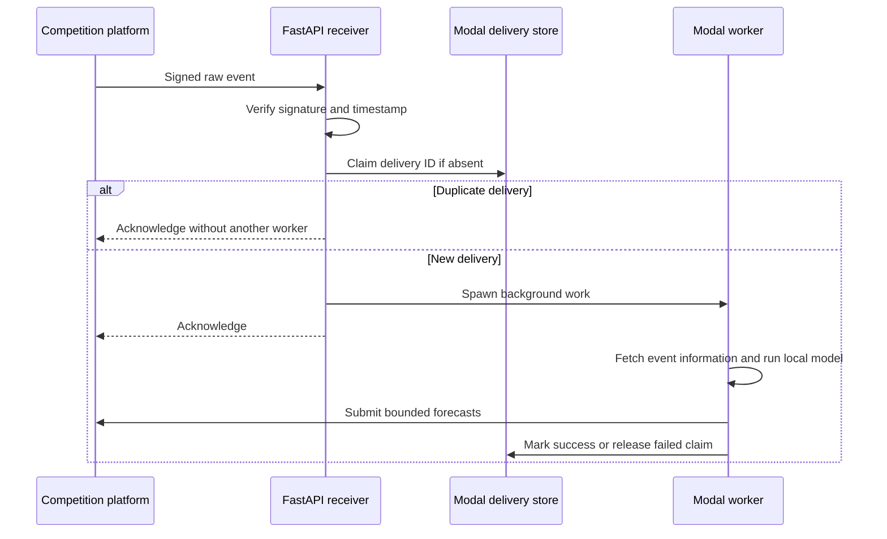

# Engineering overview

[Project overview](README.md) · [Research and validation](RESEARCH.md)

The engineering goal is to turn a reproducible research artifact into a bounded forecast inside an event-driven submission workflow. The integration extends the competition's Modal starter; this page describes the combined system and identifies the model-specific work.

## Separate research from serving

The offline path uses pandas, NumPy, and scikit-learn to construct features, fit the Ridge heads, compare quarterly validation results, and export a JSON/gzip artifact. The artifact contains the vocabulary, IDF values, model coefficients, normalization parameters, and frozen historical lookup.

The serving path loads that artifact and reproduces tokenization, sublinear term frequencies, L2 normalization, linear scoring, and ensemble adjustments using Python's standard library. It does not require a live external model-provider request for the published local v2 path.

**Trade-off:** export makes serving lightweight and deterministic, but creates a compatibility boundary. Feature normalization and artifact discovery need tests so research and serving do not silently diverge.

## Receive, acknowledge, and submit

The receiver verifies the unmodified request bytes before parsing the event. Delivery IDs are claimed through the store's conditional insert operation. The asynchronous request handler uses Modal's async interfaces so storage and spawning do not invoke blocking wrappers inside the event loop.

Prediction and submission run in a separate worker. Completed deliveries retain their claim; a caught worker failure releases its claim so a later redelivery can try again. This is duplicate suppression, not an exactly-once delivery guarantee.

**Boundary:** releasing a claim does not schedule a retry. Once an event has been acknowledged, a later worker failure may require external recovery. The current worker has no automatic Modal retries, and abrupt termination can bypass normal cleanup. These are operational limitations of the existing flow.

## Fallback behavior

The local model returns neutral 0.50 when required facts or its artifact are unavailable, when no usable vocabulary features are found, or when local inference fails. Unknown tickers receive a neutral historical prior. Missing or invalid option statistics skip the option scaling step. Valid forecasts are clipped to [0, 1].

This model fallback is separate from transport reliability: an event-information fetch or submission failure is not proof that a neutral forecast reached the platform. Worker errors are logged, and successful submission is tracked separately from webhook acknowledgement.

## Verification

**31 offline tests passed on October 30, 2026** across the prediction, text-model, webhook-verification, and Modal-handler suites.

| Boundary | Representative checks |
| --- | --- |
| Text features | Expected sublinear TF-IDF and L2 weights |
| Model behavior | Neutral output without facts; prior-surprise adjustment; option scaling around neutral |
| Artifact packaging | Model discovery in the Modal filesystem layout |
| Webhook integrity | Valid signatures, body tampering, stale timestamps, missing headers, secret rotation |
| Delivery handling | Signed event spawns work; in-flight duplicate is skipped; async interfaces are used |
| Worker lifecycle | Successful submission marks completion; failure releases the claim |

The suite uses mocked network/service boundaries and includes inherited starter checks. This run verifies local behavior; it is not a production load test, a new live submission, or a rerun of historical model training. One dependency deprecation warning was emitted by the FastAPI/Starlette test client.

## Ownership and public boundary

My contributions center on model research, feature engineering, temporal evaluation, training/export, and integrating and testing deterministic local inference. The competition's starter supplies the baseline FastAPI/Modal webhook and submission framework.

This showcase publishes documentation only. Source code, trained weights, vocabulary, datasets, event payloads, credentials, webhook endpoints, and deployment configuration are not included. See [attribution and usage](NOTICE.md).
