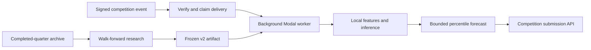

# Optiver Explaining Markets

**From earnings-call text to automated market-response forecasts.**

An independent competition project by **Zichen (Joe) Zhu**, combining statistical NLP, quarterly walk-forward evaluation, and event-driven inference on Modal.

[Public model card](https://explainingmarkets.ai/models/s_e01164bd47b2) · [Research and validation](RESEARCH.md) · [Engineering overview](ENGINEERING.md)

> This repository is a public project showcase. The implementation, trained artifacts, research data, and deployment configuration remain private.

## The problem

Given an earnings-release event, predict the focal stock's percentile rank of next-day abnormal, market-adjusted return within the contest period. The challenge is to extract information beyond the earnings surprise itself, while evaluating chronologically and delivering each forecast through a time-bounded webhook workflow.

## What I built

- **A two-head TF-IDF/Ridge ensemble:** one head learns earnings-surprise-adjusted return targets; the other distills reference forecasts from the official historical archive.
- **A v2 signal pipeline:** a frozen prior-quarter surprise lookup adds a mean-reversion signal, while valid option-implied moves scale the forecast's distance from neutral.
- **A chronological research workflow:** train on earlier quarters, evaluate on the next quarter, compare candidates, and export a deterministic inference artifact.
- **A local inference integration on Modal:** serve the exported model within the competition's signed-webhook and background-submission workflow, without an external model-provider call at inference time.

The deployment builds on the competition's Modal starter. My project work focuses on the research, feature construction, model training/export, local inference, and validation; the signed-webhook foundation is credited to that starter.

## System at a glance

## Evidence

| Area | Verified scope |
| --- | --- |
| Training snapshot | 8,656 usable events from 2025Q4 through 2026Q3 |
| Text representation | Up to 30,000 word unigram/bigram TF-IDF features |
| Historical evaluation | v2 improved incremental R² over v1 in each of three quarterly validation folds; see methodology and caveats below |
| Core application checks | 31 offline tests passed on October 30, 2026 |
| Public model description | Earnings TF-IDF/Ridge v2; model card updated October 17, 2026 |

Historical validation is model-selection evidence, not trading P&L or a claim about current leaderboard performance. [Read the evaluation details →](RESEARCH.md)

## Stack

**Python · pandas · NumPy · scikit-learn · TF-IDF · Ridge regression · Modal · FastAPI · pytest**

Training uses scikit-learn; the exported local inference path uses a compact JSON/gzip artifact and Python's standard library. [Read the architecture and failure handling →](ENGINEERING.md)

## Scope

This is independent participation in the [Explaining Markets competition](https://explainingmarkets.ai/), not employment at or endorsement by Optiver. The model is linear and lexical: numerical reasoning, changes in market regime, and incomplete option coverage remain limitations. See [research limitations](RESEARCH.md#limitations) and [attribution](NOTICE.md).
